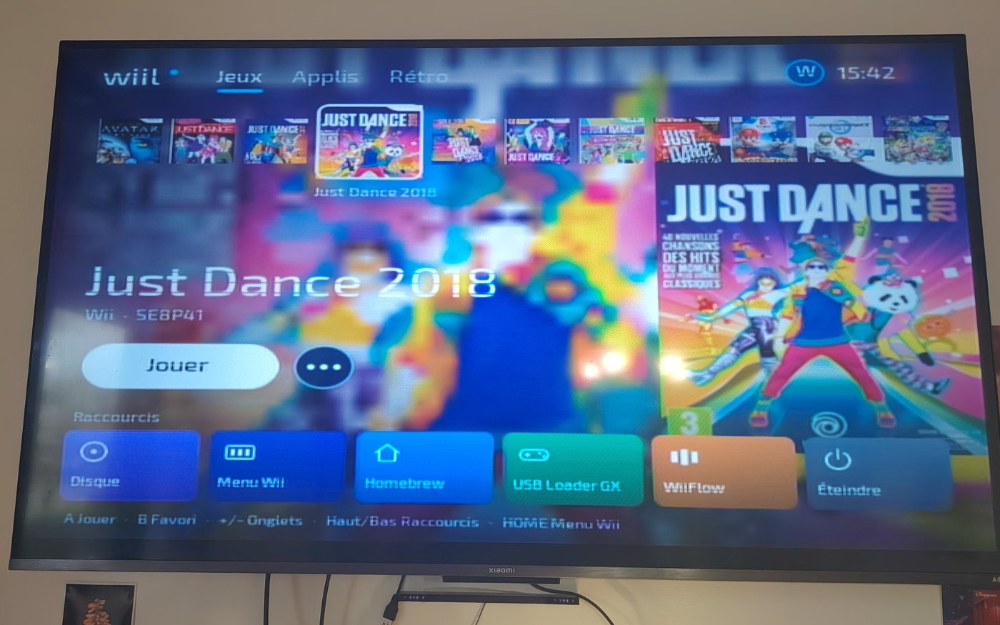
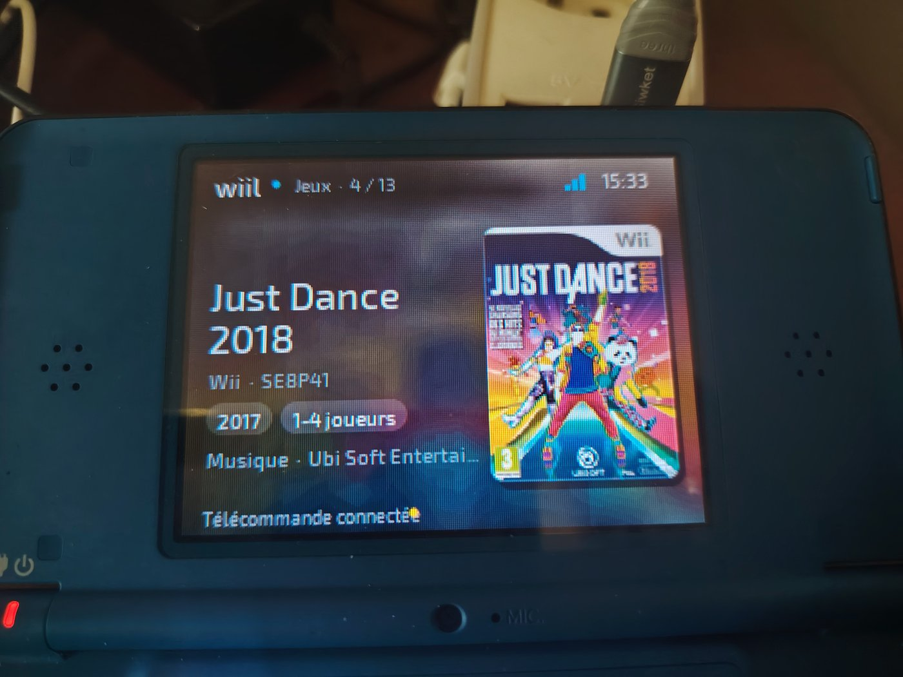
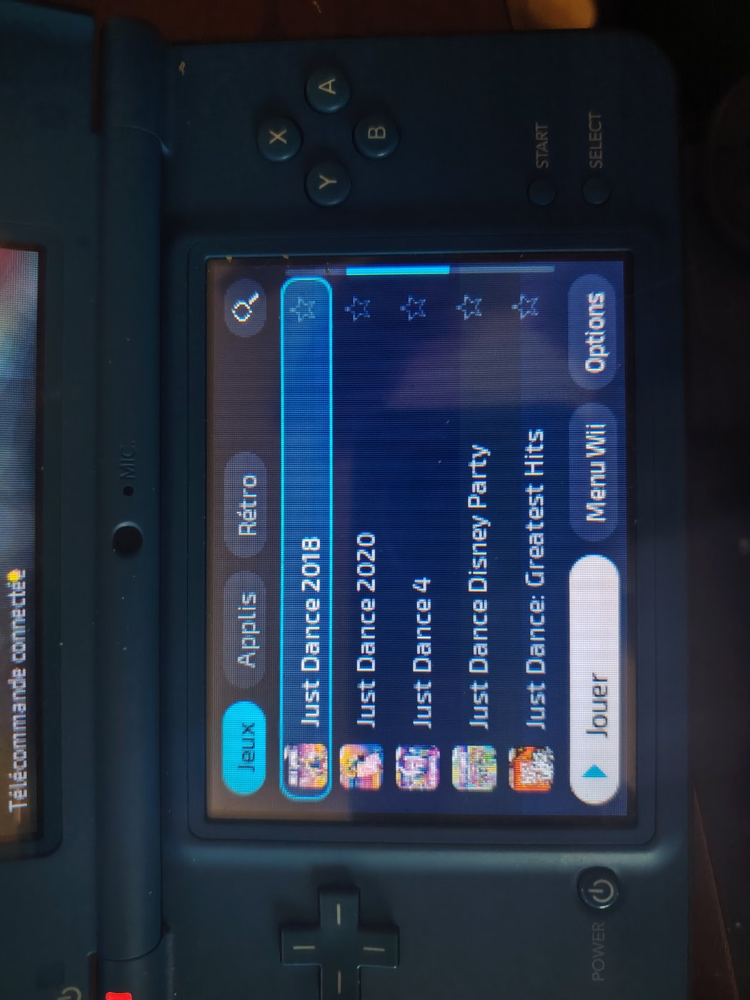

# Wiil — un menu Wii moderne, et une DSi comme télécommande

**Wiil** est un menu d'accueil homebrew pour la Wii, au style des consoles récentes :
grand visuel flou du jeu sélectionné, rangée de tuiles, onglets Jeux / Applis / Rétro,
raccourcis, musique d'ambiance, favoris. **Wiil DSi** transforme une Nintendo DSi en
télécommande Wi-Fi et en second écran tactile pour Wiil (liste des jeux, jaquette,
fiche du jeu, recherche).

> Projet amateur, non affilié à Nintendo. « Wii », « DSi » et les noms des jeux
> appartiennent à leurs propriétaires. Aucun jeu ni fichier Nintendo n'est fourni :
> Wiil affiche les jeux que tu as déjà copiés depuis tes propres disques.

## En images

| Wiil DSi : le jeu sélectionné | Wiil DSi : la liste tactile (favoris, recherche) |
|---|---|
|  |  |

Les maquettes d'origine sont dans le dossier [`maquettes`](maquettes).

## Ce qu'il faut

**Wii** : console avec la Chaîne Homebrew, cIOS d2x (249), [USB Loader GX](https://github.com/wiidev/usbloadergx)
pour lancer les jeux, jaquettes au format `ID6.png` (téléchargées par WiiFlow ou
USB Loader GX) et `wiitdb.xml` pour les noms et les fiches des jeux.
Optionnel : Priiloader pour démarrer Wiil avec la console.

**DSi** : console avec TWiLight Menu++ (le programme doit tourner en mode DSi pour le
Wi-Fi WPA2), sur le même réseau que la Wii.

## Compiler

- **Wii** (`wii/`) : [devkitPro](https://devkitpro.org) (devkitPPC, libogc, et les paquets
  `ppc-freetype ppc-libpng ppc-zlib ppc-libjpeg-turbo ppc-bzip2 ppc-libogg ppc-libvorbisidec libfat-ogc`).
  GRRLIB 4.6.1 est inclus dans `wii/grrlib`.
  - `cd wii/booter && ./build.sh` (petit lanceur, déjà compilé dans `data/booter.bin`)
  - `cd wii && make` → `wiil.dol` (à copier en `sd:/apps/wiil/boot.dol`)
  - `cd wii/demarrage && make` → lanceur à installer dans Priiloader (« Install File »)
- **DSi** (`dsi/`) : [BlocksDS](https://blocksds.skylyrac.net) 1.15.1 ou plus récent
  (pilote Wi-Fi en mode DSi avec WPA2). `cd dsi && make` → `wiil_dsi.nds`.
- **Images et police** : scripts Python (Pillow) dans `wii/outils` et `dsi/outils`.

## Utilisation

**Wiil (Wii)** : ◀ ▶ choisir · ▲ ▼ tuiles / boutons / raccourcis · A jouer · B favori · + / − onglets ·
HOME menu Wii. Les jeux sont lancés par USB Loader GX (démarrage rapide
par ID). Les favoris sont dans `sd:/apps/wiil/favoris.txt`, les fiches en cache dans
`sd:/apps/wiil/titres.txt`.

**Wiil DSi** : au premier lancement, choisir le réseau et taper le mot de passe (il est
ensuite retenu dans `sd:/_nds/wiil_dsi.ini`, **en clair** ; « Options > Oublier le réseau »
l'efface). La croix et les boutons font comme la Wiimote ; l'écran tactile permet de
choisir un jeu, de faire défiler, de chercher (loupe), de marquer un favori (étoile) et
de lancer (Jouer). Y affiche les messages de débogage.

**Test sans la Wii** : `python dsi/pc/recepteur.py` sur un PC du même réseau répond aux
messages « bonjour » de la DSi.

## Protocole (UDP, port 4242, texte)

| DSi → Wii | Réponse de la Wii |
|---|---|
| `BONJOUR` (diffusé à tout le réseau) | `WIIL` |
| `TOUCHE GAUCHE/DROITE/HAUT/BAS/A/B/PLUS/MOINS/HOME/JOUER` | `SEL o\|i\|zone\|nom` |
| `LISTE o` | `LST o\|n` puis `ITM o\|i\|favori\|nom` pour chaque élément |
| `ITMP o i` (élément perdu) | `ITM o\|i\|favori\|nom` |
| `CHOISIR o i`, `FAV o i` | `SEL …` / `ITM …` |
| `INFO o i` | `INF o\|i\|type\|id\|année\|joueurs\|genre\|éditeur` |
| `IMG o i`, `IMGP o i k` | `IMG o\|i\|l\|h\|k\|nk` + morceau d'image (RGB 15 bits) |
| `MINI o i` | `MIN o\|i\|20\|20` + vignette |

La Wii envoie aussi `SEL …` dès que la sélection change. `o` = onglet (0 Jeux, 1 Applis, 2 Rétro).

## Limites connues

- La télécommande DSi fonctionne dans Wiil, pas pendant les jeux.
- Le lancement direct d'un disque depuis Wiil est expérimental et désactivé (la carte
  « Disque » ouvre le menu Wii, où la chaîne Disque fonctionne).

## Licences

Voir [LICENCES-TIERS.md](LICENCES-TIERS.md) pour les bibliothèques et la police utilisées.
Code de Wiil et Wiil DSi : licence **MIT** (voir `LICENSE`), © 2026 WILL. Police Exo 2 : SIL Open Font License 1.1 (`OFL.txt`).
